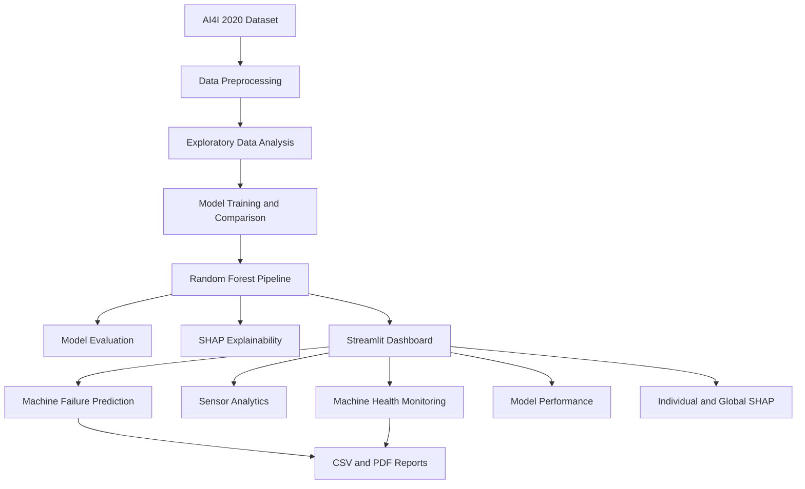

# AI-Powered Predictive Maintenance & Equipment Intelligence System

An interactive machine learning application that predicts potential machine failures using sensor data, explains model predictions using Explainable AI (SHAP), and provides machine health insights through a Streamlit dashboard.

## Project Overview

Unexpected equipment failures can lead to production downtime, maintenance costs, and operational disruptions.

This project uses machine learning to identify potential equipment failures based on machine operating conditions and sensor measurements.

The system provides:
- Machine failure prediction.
- Failure probability estimation.
- Interactive sensor analytics.
- Machine health monitoring.
- Model performance evaluation.
- Individual and global SHAP explanations.
- Downloadable prediction reports in CSV and PDF formats.

**Note:** This project uses the AI4I 2020 simulated predictive maintenance dataset. It is a machine learning demonstration, not a live industrial monitoring system.

## Technology Stack

| Category | Technologies |
|---|---|
| Programming Language | Python |
| Data Processing | Pandas, NumPy |
| Machine Learning | Scikit-learn |
| Model | Random Forest Classifier |
| Explainable AI | SHAP |
| Visualization | Plotly, Matplotlib, Seaborn |
| Web Application | Streamlit |
| Model Storage | Joblib |
| PDF Reports | ReportLab |

## Dataset

**AI4I 2020 Predictive Maintenance Dataset**

- Total records: 10,000
- Dataset type: Simulated industrial predictive maintenance data
- Failure rate: Approximately 3.39%

### Sensor Features

- Air Temperature [K]
- Process Temperature [K]
- Rotational Speed [rpm]
- Torque [Nm]
- Tool Wear [min]
- Machine Type

### Target

Machine failure prediction (`Machine failure`).

The dataset is used to train and evaluate the machine learning model.

Dataset source: [UCI Machine Learning Repository – AI4I 2020](https://archive.ics.uci.edu/dataset/601/ai4i+2020+predictive+maintenance+dataset)

## System Architecture



## Machine Learning Workflow

1. Load the AI4I 2020 dataset.
2. Perform data cleaning and preprocessing.
3. Conduct exploratory data analysis.
4. Prepare training and testing datasets.
5. Train and compare machine learning models.
6. Select the Random Forest model.
7. Evaluate model performance.
8. Save the trained model using Joblib.
9. Integrate the model into the Streamlit application.
10. Generate prediction explanations using SHAP.

## Model Performance

The selected Random Forest model was evaluated on the test dataset.

| Metric | Result |
|---|---:|
| Accuracy | 97.45% |
| Precision | 59.55% |
| Recall | 77.94% |
| F1-Score | 67.52% |
| ROC-AUC | 0.9682 |
| Average Precision | 0.7588 |

### Confusion Matrix

| | Predicted Normal | Predicted Failure |
|---|---:|---:|
| Actual Normal | 1896 | 36 |
| Actual Failure | 15 | 53 |

**Important:** Accuracy alone is not sufficient for evaluating predictive maintenance models. Recall and precision are also important because missed failures and false alarms have different operational consequences.

## Explainable AI – SHAP

The application integrates SHAP (SHapley Additive exPlanations) to make machine learning predictions more interpretable.

### Individual Explanation
- Explains a specific machine prediction.
- Identifies features contributing to the prediction.
- Displays positive and negative feature contributions.

### Global Explanation
- Shows overall feature importance.
- Helps understand which sensor measurements influence model predictions across the dataset.

SHAP values explain model behavior; they do not establish physical causes of machine failure.

## Streamlit Dashboard Modules

The application contains seven main modules.

### 1. Overview
- Project introduction.
- Key performance indicators.
- Dataset and model summary.

### 2. Machine Prediction
- Enter machine type and sensor readings.
- Predict potential machine failure.
- Display failure probability.
- Download prediction reports.

### 3. Sensor Analytics
- Interactive sensor visualizations.
- Sensor distribution analysis.
- Relationships between operating parameters.

### 4. Machine Health
- Machine health monitoring based on prediction results.
- Failure probability insights.
- Health status visualization.
- Downloadable reports.

### 5. Model Performance
- Classification metrics.
- Confusion matrix.
- Model evaluation visualizations.

### 6. Explainable AI
- Individual SHAP explanations.
- Global SHAP feature importance.
- Prediction interpretability.

### 7. About Project
- Project information.
- Technology stack.
- Dataset details.
- Model limitations.

## Prediction Reports

The application supports downloadable reports.

**CSV Report**
- Prediction result.
- Failure probability.
- Machine type.
- Sensor readings.

**PDF Report**
- Prediction summary.
- Machine sensor information.
- Failure probability.
- SHAP explanation when available.
- Model limitations.

## Project Structure

```text
Predictive_Maintenance_AI/
│
├── app.py
├── app_backup.py
├── README.md
├── requirements.txt
├── run_windows.bat
├── .gitignore
│
├── data/
│   ├── ai4i2020.csv
│   └── demo_machine_data.csv
│
├── models/
│   ├── predictive_maintenance_model.joblib
│   ├── metrics.json
│   └── model_comparison.csv
│
└── src/
    ├── train_model.py
    ├── eda.py
    └── pdf_report.py
```

## Installation and Setup

### Prerequisites

- Python 3.10 or later.
- pip package manager.
- Git (for cloning the repository).

### 1. Clone the Repository

```bash
git clone YOUR_GITHUB_REPOSITORY_URL
```

### 2. Navigate to the Project

```bash
cd Predictive_Maintenance_AI
```

### 3. Create a Virtual Environment

```bash
python -m venv .venv
```

### 4. Activate the Virtual Environment

**Windows PowerShell:**

```powershell
.\.venv\Scripts\Activate.ps1
```

### 5. Install Dependencies

```bash
pip install -r requirements.txt
```

### 6. Run the Application

```bash
streamlit run app.py
```

The application will open in your browser, usually at:

```text
http://localhost:8501
```

## Limitations

- Uses simulated AI4I 2020 benchmark data rather than real industrial sensor streams.
- Predictions depend on the training dataset and learned patterns.
- Model performance on simulated data may differ from real factory environments.
- SHAP explanations describe model behavior and should not be interpreted as confirmed physical causes.
- The application does not currently connect to live industrial IoT devices.
- Failure probabilities should not be treated as calibrated real-world failure risks.

## Future Enhancements

- Real-time IoT sensor integration.
- Live machine monitoring.
- Predictive maintenance scheduling.
- Time-series forecasting.
- Cloud deployment.
- Automated maintenance alerts.
- Integration with industrial equipment systems.


**Developed as an AI and Machine Learning Predictive Maintenance Project.**
